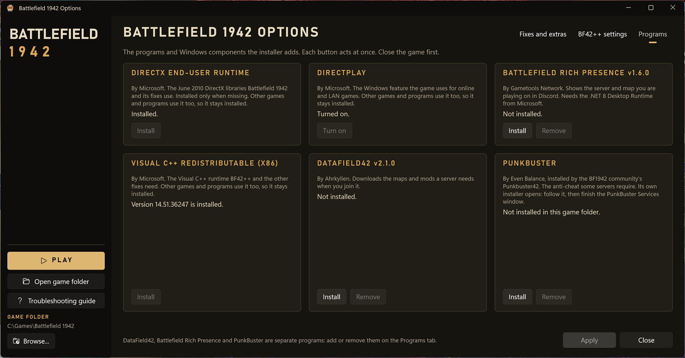
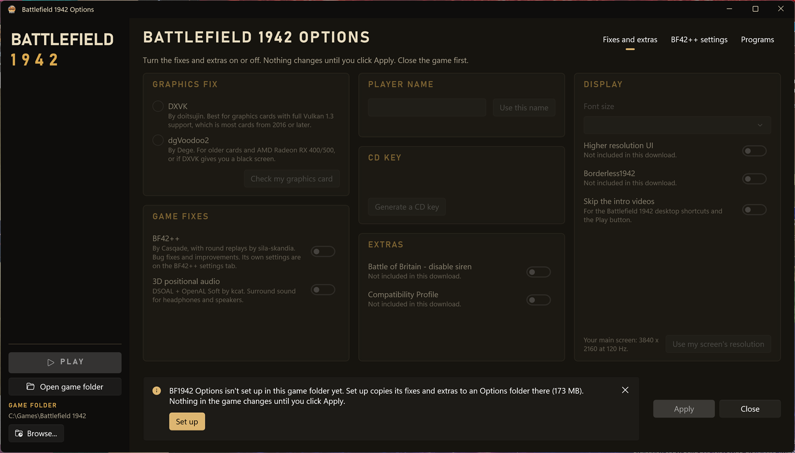
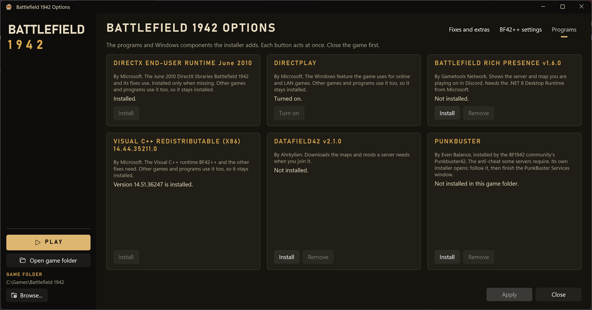

# BF1942-Installer-Options

**Battlefield 1942 Options**: the app that [BF1942-Installer](https://github.com/AnomalousNicole/BF1942-Installer) installs next to the game, so players can turn the fixes and extras on or off after install, without the setup file.

This repository is the app's source. BF1942-Installer includes it as a git submodule at `installer\BF1942Options`, and its `build.ps1` builds the app into every installer. To build an installer, start from **[BF1942-Installer](https://github.com/AnomalousNicole/BF1942-Installer)**.

It also works **on its own**, with Battlefield 1942 folders that BF1942-Installer did not install: `build.ps1 -Standalone` in BF1942-Installer builds `BF1942-Options-Standalone.zip`, the app with every fix and extra it switches, and the runtimes for the **Programs** tab, which installs and removes the separate programs the installer adds in any game folder. See [On its own](#on-its-own).




---

## What it does

One window, in a Battlefield 1942 theme, with three tabs: **Fixes and extras**, **BF42++ settings** and [**Programs**](#the-programs-tab). **Fixes and extras** has every option the installer can switch on one page:

| Option | What it changes |
|---|---|
| Graphics fix | DXVK or dgVoodoo2. **Check my graphics card** runs the same Vulkan check as Setup and picks the right one. Switching swaps the DLLs; `dxvk.conf` and `dgVoodoo.conf` stay in the folder with the player's settings (each fix reads only its own) |
| BF42++ and 3D positional audio | Each on or off on its own. With BF42++ on, DSOAL sits behind BF42++'s `dsound.dll` as `dsound_next.dll`; without it, DSOAL is `dsound.dll` |
| Font size | One of the `Font.rfa` files the installer ships |
| Higher resolution UI, Battle of Britain siren | The modified or the original `menu.rfa` / `Battle_of_Britain.rfa` |
| Borderless1942 | Its exe, a desktop shortcut and windowed mode in `VideoDefault.con` |
| Compatibility Profile | Registers or removes `BF1942.sdb` with `sdbinst` |
| Skip the intro videos | `+restart 1` on the desktop shortcuts |
| Resolution | **Use my screen's resolution** sets every `Video*.con` to the main screen |
| Player name | **Use this name** works like Setup's *Set your player name* in BF1942-Installer: it copies the profile the game starts with to `Settings\Profiles\<name>` (spaces and characters a folder name can't have become `_`), sets the name in it and makes it the one the game starts with |
| CD key | **Generate a CD key**, only when no valid key is registered |

**BF42++ settings** has BF42++'s own settings from `bf42++.ini`, in cards: HUD, chat and console, 3D map markers, controls, performance, and graphics and files (screenshot format, round replays, unpacked game files). Each is a switch, a list or a text box, and the buddy colours are swatches in the order BF42++ hands them out: **+** adds one from a palette (or any colour with **Other colour...**), and clicking a swatch moves it or takes it out. Pointing at a setting's name shows what it does and BF42++'s default. The list, with BF42++'s defaults and ranges, is in `BF42ppSettings.cs`; it follows [sila-skandia/bf42plus](https://github.com/sila-skandia/bf42plus) (Casqade's bf42++ with round replays). Apply writes only the settings that changed, each in place of its own line, so the file's comments, buddy colours and ignore list stay. A colour or number BF42++ wouldn't take keeps Apply off until it is fixed. When the game folder has no `bf42++.ini`, the tab shows the library's copy, which Apply puts there.

The left side has **Play**, **Join** (when the installer has a server shortcut), **Join our Discord** (when it has a Discord invite), **Open game folder** and the **Troubleshooting guide**, and the game folder with **Browse...** to pick another one. With Borderless1942 on, **Play** and **Join** start the game through it, like its desktop shortcut. The app runs as administrator, but it starts the game, folders and links as the signed-in user.

## How it works

- **The library.** Setup keeps a copy of every fix the app can switch, plus the game's original files that the extras replace, in `{app}\Options`, and the separate programs' installers in `{app}\Options\Programs` (whatever was picked). It installs the app in `{app}\Options\App`.
- **The game folder.** Below the folder's path on the left, **Browse...** picks another Battlefield 1942 folder. It must have `BF1942.exe` in it, and the app then uses the library in its `Options` folder. A folder with a library is remembered in the state key (`GameFolder`) and opens the next time. Without a remembered folder, the app opens the folder it is installed in, or else the one in the game's registry entry (`GAMEDIR`, which Setup writes too), whichever has `BF1942.exe`. So a copy of the app downloaded on its own, from this repository's Releases, finds the game, or can be pointed at it.
- **On its own.** A standalone copy (see below) has the library next to the exe, in `Library`. A game folder without a library then gets a **Set up** button instead of an error. See [On its own](#on-its-own).
- **Every tab fits.** The window is sized for the tab that needs the most room, and the cards on every tab end on the same line, so switching tabs never scrolls.
- **What is on** is read from the game folder every time: a file counts as on when it is identical (SHA-256) to its copy in the library. Extras that the installer was built without have no copy, and show as *Not included in this installer* (Borderless1942 on 32-bit Windows as *Only available on 64-bit Windows*); a font size without a copy is greyed out in the list.
- **`options.json`** next to the exe tells the app what the installer was built with. BF1942-Installer's `build.ps1` writes it from `config.json`:

  | Key | Meaning |
  |---|---|
  | `stateKey` | The registry key Setup keeps its state in (`registryStateKey`), under `HKLM\SOFTWARE\WOW6432Node` on 64-bit Windows (`HKLM\SOFTWARE` on 32-bit) |
  | `generateSerial` | Whether the CD key card is shown (`generateSerial`) |
  | `serverShortcut`, `serverAddress` | The server shortcut's name and `ip:port`, for **Join** (`serverShortcutName`, `serverAddress`) |
  | `discordUrl` | An invite for **Join our Discord** (`discordUrl`) |
  | `separatePrograms` | The separate programs the installer can add (DataField42, Battlefield Rich Presence, PunkBuster: the ones the build includes), named in the note at the bottom. An empty list hides the note |

- **`versions.json`** in the library has the BF42++, DXVK and dgVoodoo2 versions the app shows next to each fix. A library from an older Setup has none, and the versions come from the state key (`VerBF42PP`, `VerDXVK`, `VerDgVoodoo2`).

- **`cover.bmp`** next to the exe, when there is one, is shown at the top of the left side. `build.ps1` copies your largest `branding\WizardImage*.bmp`; without it the side shows the game's name.
- **The player's own files are kept.** Before Apply replaces or removes a file in the game folder that is none of the library's copies (a `d3d8.dll` or `dsound.dll` from another fix or mod, a font of their own, ...), it copies it to `Options\Backup`, at the same path, and the message after Apply names it. A second file of the player's own by that name gets the time in its name.
- **Administrator rights.** The manifest asks for them, because the app writes to the game folder and `HKLM`, and runs `sdbinst`. Every change is logged to `{app}\Options\Options.log`.

## On its own

`.\build.ps1 -Standalone` in BF1942-Installer writes `output\BF1942-Options-Standalone.zip`: the app, with an `options.json` that uses a state key of its own (`SOFTWARE\BF1942 Options`), and the library Setup would keep in the game folder in `Library` next to the exe. The app counts as standalone when `Library\BF42++` is there.



1. Players extract the zip anywhere and run `BF1942 Options.exe`. It opens the folder from the game's registry entry or the one it was extracted in, or they click **Browse...**.
2. In a folder without an `Options` library, **Set up** copies `Library` to `Options` in the game folder. `Options\Originals` gets the folder's own `menu.rfa` and `Battle_of_Britain.rfa`, unless they are the modified ones already (then the library's originals are used, when the build had a game folder). The game itself doesn't change.
3. From then on the folder works like one Setup installed: the switches show what is on, and **Apply** changes it. Files that are neither fix, like another `d3d8.dll`, show as *neither DXVK nor dgVoodoo2* until a fix is picked. Every file of the folder's own that Apply replaces or removes (DLLs, `Font.rfa`, ...) is kept in `Options\Backup` first.

An extra that is on already in a folder with no original to go back to (for example a folder that already has the higher resolution `menu.rfa`) shows as on, with a note that it can't be switched. To undo the set up, switch the fixes off, copy back what you want from `Options\Backup`, and delete `Options` in the game folder.

## The Programs tab

The third tab, **Programs**, has a card for each of the other things Setup's components page offers, with what is installed now and **Install** (or **Repair**, **Update**, **Turn on**) and **Remove**. DataField42, Battlefield Rich Presence and PunkBuster can be installed and removed at any time, also when they weren't picked during install, in any game folder with a library: their installers are in its `Options\Programs`, which Setup installs and **Set up** copies (from a standalone copy's `Library\Programs`). Microsoft's runtimes (DirectX, Visual C++ and the .NET 8 Desktop Runtime that Battlefield Rich Presence needs) only come with a standalone copy, in `Programs` next to the exe; elsewhere a card that needs one says running the installer again installs it, or where to get .NET 8. Each `Programs` folder has a `programs.json` naming each installer's file and version, and the app uses the first folder that has one: next to the exe, then the game folder's library. `Programs.cs` does what Setup and its uninstaller do (`installer\BF1942-Installer.iss` in BF1942-Installer), and logs it to `Options.log`:



| Program | Install | Remove |
|---|---|---|
| DirectX End-User Runtime (June 2010) | `DXSETUP.exe /silent`, when one of its DLLs is missing from `SysWOW64` | None: other games use it, and it has no uninstaller |
| Visual C++ Redistributable (x86) | `/install` when it is missing or older than the download's, `/repair` when it is registered but `msvcp140.dll` or `vcruntime140.dll` is gone | None: other programs use it |
| DirectPlay | Turned on with DISM (its state comes from `Get-WindowsOptionalFeature`) | None: other games use it |
| DataField42 (64-bit Windows) | Its installer, into this game folder, then closes the DataField42 it starts as administrator. It can be in one game folder per PC | Its uninstaller; then `BF1942.exe` as it was before DataField42 patched it (kept in `Options\Backup\Before DataField42` when the app installed it; otherwise DataField42's patch is taken out byte for byte, when `BF1942.exe` has all of it) and DataField42's settings folder |
| Battlefield Rich Presence (64-bit Windows) | The .NET 8 Desktop Runtime when it is missing (from a standalone copy; otherwise the card says to get it from Microsoft first), then the MSI | `msiexec /x`; .NET 8 stays, as other programs use it |
| PunkBuster | Punkbuster42, which opens its own windows, in this game folder; waits for the PunkBuster Services window to close | `pb`, `pbsvc.exe` and BF1942's PunkBuster entry in Apps, and the PunkBuster Services when no other game uses them (looked for like Setup's uninstaller does: Apps, EA's registry keys, the usual game folders and every Steam library) |

Each button acts at once and needs every copy of the game closed. A program whose installer neither folder has shows *Not included in this download* in a standalone copy, and in the copy Setup installs that running the installer again adds it (a library from an older Setup has no `Programs`), or *Not included in this installer* when the build left it out.

## Building

`build.ps1` in BF1942-Installer does this for you. By hand:

```powershell
dotnet publish BF1942Options.csproj -c Release -o publish -p:GameIcon="C:\path\to\Battlefield 1942\bf1942.ico"
```

- Needs the [.NET 10 SDK](https://dotnet.microsoft.com/download/dotnet/10.0) (`winget install --id Microsoft.DotNet.SDK.10 --exact`).
- WinUI 3 (Windows App SDK), 32-bit, self-contained and trimmed: players need no .NET or Windows App SDK, and it runs on Windows 10 version 1809 or later and Windows 11. The folder is about 70 MB.
- `GameIcon` is optional; it sets the exe and window icon to the game's.

## License

MIT - see [LICENSE](LICENSE). The published app includes the .NET runtime and the Windows App SDK (both MIT, by Microsoft).
